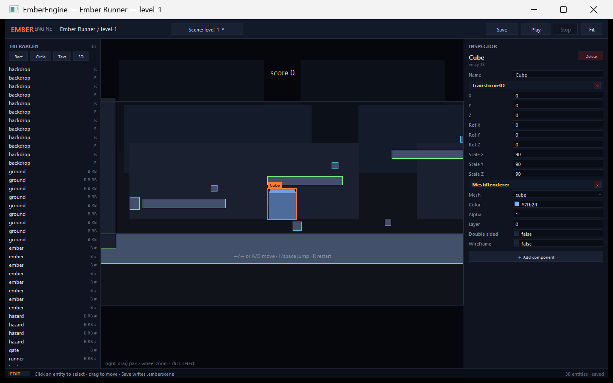

# EmberEngine

A TypeScript game engine with a native Windows editor and standalone executable builds.
Deno is the single toolchain: runtime, test runner, browser bundler and `.exe` compiler.



## Features

- **2D and 3D in one frame** — sprites, shapes, text, meshes, 2D camera and 3D camera
  compose into one ordered draw list.
- **Native editor** — a real Win32/GDI window with hierarchy, viewport, inspector, entity
  creation, 3D mesh editing, Play mode, and `.emberscene` save/load. No browser, webview or
  local server.
- **Data-driven scenes** — `.emberscene` JSON scenes with a versioned format.
- **Same runtime everywhere** — the editor's Play mode, headless tests, and exported games
  run the same simulation code.
- **No third-party runtime dependencies.**

## Quick start

```bash
deno task editor        # open the native editor from source
deno task play          # play the sample game
deno task test          # run the test suite
```

### Build the native editor executable

```bash
deno task build:editor
./dist/EmberEngine.exe
```

`EmberEngine.exe` is self-contained and needs no Deno install. It embeds the sample game,
loads authored `scenes/*.emberscene` files next to the executable when present, and saves
edits there. Pass `--scenes <dir>` to choose another scene folder, or `--debug` to keep the
console visible.

### Export a game

```bash
deno task export
```

Exported games are standalone Windows executables that serve their player locally and open
it in the default browser. The editor itself is native.

## Layout

```
packages/core        math, ECS, scenes, serialization, input, time
packages/render2d    2D draw commands, camera, canvas backend
packages/render3d    meshes, 3D camera, triangle pipeline, mixed frame ordering
packages/runtime     fixed-step loop, systems, sessions, game runtime
packages/editor      native Win32/GDI authoring application
packages/player      exported-game browser host
packages/packager    export bundles and deno compile
packages/cli         ember command routing
games/ember-runner   sample platformer
tests/               unit, game, integration and export suites
legacy/cpp-engine    superseded C++/OpenGL prototype, kept for reference
```

See [docs/architecture.md](docs/architecture.md) and [docs/test-plan.md](docs/test-plan.md)
for the ownership model and verification strategy.

## License

Apache License 2.0. See [LICENSE](LICENSE).
