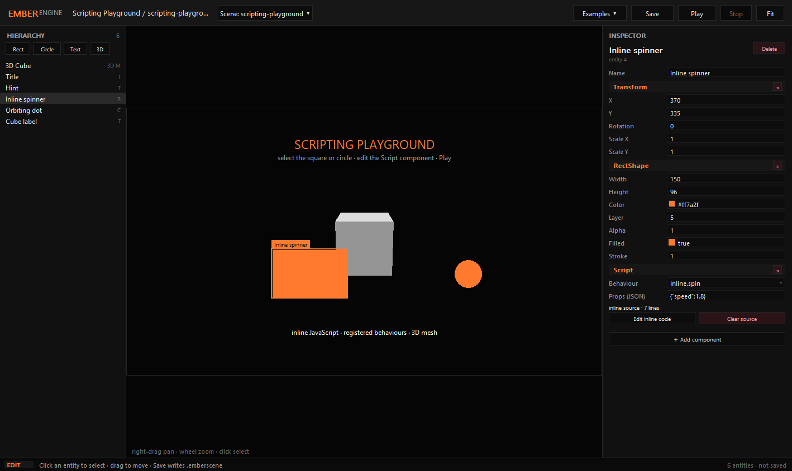
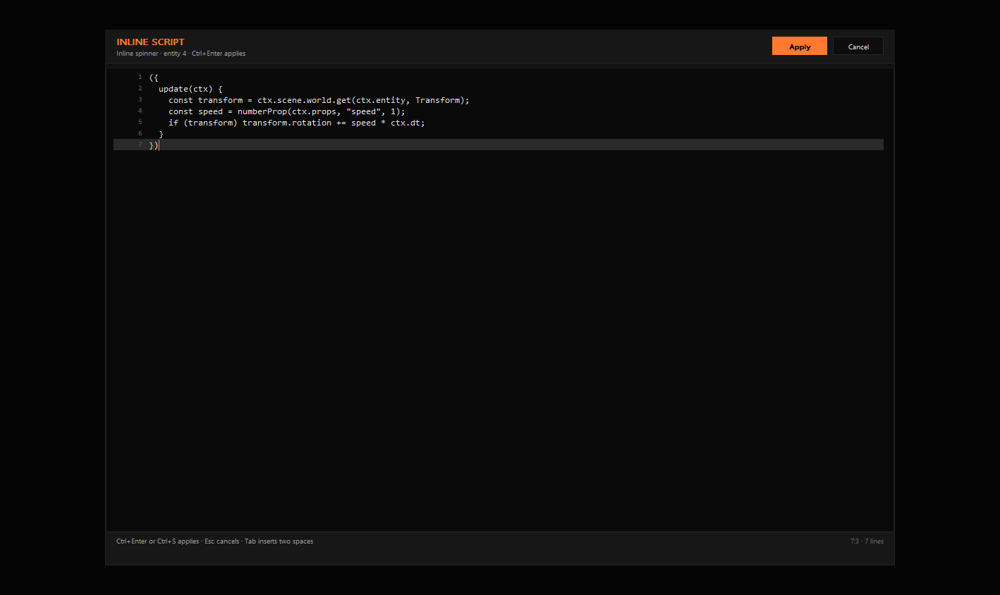

# EmberEngine


A TypeScript game engine with a native Windows editor and standalone executable builds. Deno is the
single toolchain: runtime, test runner, bundler and `.exe` compiler.



## Features

- **2D and 3D in one frame** — sprites, shapes, text, meshes, 2D camera and 3D camera compose into
  one ordered draw list.
- **Native editor** — a real Win32/GDI window with hierarchy, viewport, inspector, entity creation,
  3D mesh editing, Play mode, and `.emberscene` save/load. No browser, webview or local server.
- **Starts empty** — a fresh launch is one blank scene. Open the **Examples** menu for a scripting
  playground, a 3D showcase, or one of the two shipped games (Ember Runner and Flappy Ember); each
  opens as a full editable project and exports from the editor.
- **Inline scripting** — attach a registered behaviour or write JavaScript directly on an entity.
  The inspector has a code editor; scripts are stored in the scene, restart when applied, and report
  compile/runtime errors without stopping Play.
- **Data-driven scenes** — `.emberscene` JSON with a versioned format.
- **Same runtime everywhere** — editor Play mode, headless tests, and exported games run the same
  simulation code.
- **Agent-ready (MCP)** — a built-in Model Context Protocol server lets Claude Code, Cursor and
  other coding agents build scenes, edit entities, simulate gameplay and export the game from chat.
- **No third-party runtime dependencies.**

## Quick start

```bash
deno task editor        # native editor window (Win32/GDI)
deno task play          # play the sample game
deno task test          # run the test suite
deno task export        # build dist/ember-runner.exe
deno task mcp           # MCP server on stdio (for coding agents)
```

### Build the native editor executable

```bash
deno task build:editor
./dist/EmberEngine.exe
```

`EmberEngine.exe` is self-contained and needs no Deno install. It embeds the EmberEngine icon
(`assets/emberengine.ico`) and opens an empty project under `projects/untitled` (beside the
executable), saving scenes to `projects/untitled/scenes`. Example edits are kept separately under
`projects/untitled/examples/<id>/scenes`.

Pass `--game <dir>` to open an existing game, `--scenes <dir>` to choose the project scene folder,
or `--debug` to keep the console visible.

### Scripting

A `Script` component has three ways to configure behaviour:

1. **Registered behaviour** — a name from the game's `ScriptRegistry`, e.g. `editor.spin`.
2. **Props** — JSON passed to the behaviour as `ctx.props`.
3. **Inline source** — JavaScript edited with **Edit inline code**. Source wins over the registered
   name and is saved in the scene.

Inline source is an expression that returns callbacks:

```js
({
  start(ctx) {/* optional */},
  update(ctx) {
    const transform = ctx.scene.world.get(ctx.entity, Transform);
    const speed = numberProp(ctx.props, "speed", 1);
    if (transform) transform.rotation += speed * ctx.dt;
  },
  destroy(ctx) {/* optional */},
});
```



`Transform`, `Transform3D`, `Velocity`, `RigidBody`, `BoxCollider`, `RectShape`, `CircleShape`,
`Sprite`, `TextLabel`, `MeshRenderer`, `Tag`, `Name`, `Parent`, `Visibility`, `Lifetime`, `vec2`,
`vec3`, `rect`, `clamp`, `Colors`, `prop`, `numberProp`, `stringProp`, `worldTransform`,
`worldTransform3D` and `colliderWorldRect` are available inside inline scripts. A bare function is
treated as `update`.

### Export a game

```bash
deno task export
deno run -A packages/cli/main.ts export games/ember-runner --out "D:/Games"
```

Exporting asks where to install the game: the studio shows an **Export** dialog, and the CLI takes
`--out <folder-or-file>`. Leave it empty to keep `dist/<game>.exe`.

Exported games are standalone Windows executables that serve their player locally and open it in the
default browser. The editor itself is native.

### Drive the engine from a coding agent (MCP)

`packages/mcp` is a dependency-free Model Context Protocol server on stdio, so an MCP-capable agent
(Claude Code, Cursor, …) can build the game from chat. It drives the same loader, runtime and
packager as the CLI, so every edit lands as a real `.emberscene` on disk. `.mcp.json` is committed,
so Claude Code picks the server up with no setup:

```json
{
  "mcpServers": {
    "emberengine": {
      "command": "deno",
      "args": ["run", "-A", "--unstable-ffi", "packages/mcp/main.ts"]
    }
  }
}
```

For an agent that should not need a checkout, build the standalone server and point it at the
executable:

```bash
deno task build:mcp        # dist/EmberMCP.exe
```

Tools: `engine_info`, `component_catalog`, `scene_list`, `scene_read`, `scene_create`, `entity_add`,
`entity_update`, `entity_delete`, `simulate`, `script_check`, `export_game`. A typical loop is
`engine_info` → `scene_read` → `entity_add` / `entity_update` → `simulate` → `export_game`.

## Layout

```
packages/core        math, ECS, scenes, serialization, input, time
packages/render2d    2D draw commands, camera, canvas backend
packages/render3d    meshes, 3D camera, triangle pipeline, mixed frame ordering
packages/runtime     fixed-step loop, systems, sessions, scripting, Game
packages/editor      native Win32/GDI authoring application + examples
packages/player      exported-game browser host
packages/mcp         Model Context Protocol server (stdio) for coding agents
packages/packager    export bundles and deno compile
packages/cli         ember command routing
games/ember-runner   sample platformer
games/flappy         Flappy Ember one-button example game
tests/               unit, integration, game and export suites
legacy/cpp-engine    superseded C++/OpenGL prototype, kept for reference
```

See [docs/architecture.md](docs/architecture.md) and [docs/test-plan.md](docs/test-plan.md).

## License

Apache License 2.0. See [LICENSE](LICENSE).
